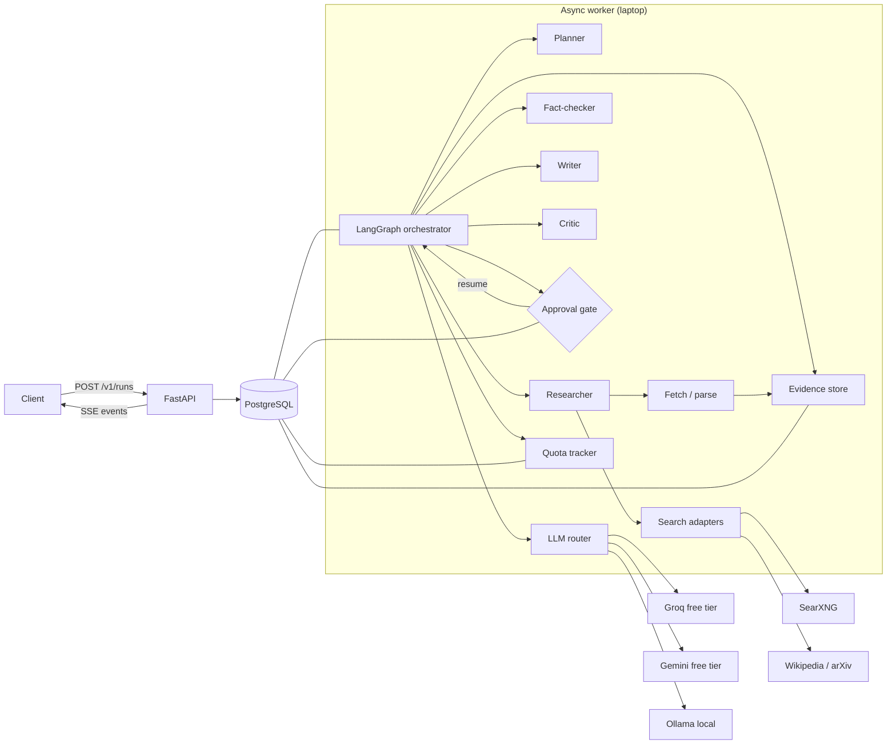

# Autonomous AI Research Agent

> A production-shaped, evidence-first research agent that plans, searches, verifies claims, and writes cited reports — with a reproducible benchmark comparing single-agent and multi-agent architectures under a **$0 budget**.

**Status: Phase 1 — typed contracts, Postgres schema, tool layer, record/replay cache.** The research graph and run API land in Phase 2. See [`docs/PHASE1_REVIEW.md`](docs/PHASE1_REVIEW.md).

---

## Why this exists

Most "AI researcher" demos are one prompt and a wall of unsourced prose. This project treats the hard parts as the product:

- **Evidence first.** Every claim carries a source span, retrieval timestamp, and verifier verdict. Unsupported claims are removed or flagged.
- **Bounded autonomy.** Hard caps on steps, tool calls, tokens, wall-clock, and cost; no unbounded agent loops.
- **Human approval where it matters.** Expensive searches, memory writes, and report export block on resumable approvals.
- **Reproducible evaluation.** Record/replay for every LLM and search call, frozen benchmark snapshots, paired statistics, and (from Phase 5) a CI replay smoke eval that makes zero live API calls.
- **Honest tradeoffs.** The benchmark is designed to show where multi-agent loses, not just where it wins.

---

## Architecture (target state)



The graph is explicit, typed, checkpointed, and loop-bounded:

```text
intake -> planner -> researcher -> evidence_store -> coverage_critic
      -> (researcher | writer) -> claim_extractor -> verifier
      -> report_critic -> (researcher | writer | approval_gate)
      -> finalize -> END
```

A single ReAct-style agent implements the same `ResearchArchitecture` interface behind the same tools, budget, evidence store, and output schema. That is what makes the benchmark fair.

---

## Quickstart (Phase 1)

**Prerequisites:** Python 3.11–3.13, [uv](https://docs.astral.sh/uv/), Docker Desktop, `make` (optional on Windows).

```bash
git clone <your-fork-url> autonomous-ai-research-agent
cd autonomous-ai-research-agent
cp .env.example .env
cp config/providers.example.yaml config/providers.yaml

# Install the package + dev tools (uses uv.lock)
uv sync --group dev

# Start Postgres + pgvector and SearXNG
docker compose up -d postgres searxng

# Apply the schema (pgvector image required)
uv run alembic upgrade head

# Verify the scaffold
make check
# or: uv run ruff check . && uv run ruff format --check . && uv run mypy src && uv run pytest

# Health/version API
uv run uvicorn research_agent.api.app:app --reload
```

Expected: Postgres and SearXNG healthy, migrations apply, lint/type/test green (103 tests, 2 pgvector-dependent skips on hosts without the extension). There is no research-run CLI yet — that lands in Phase 2.

> **PowerShell:** `Copy-Item .env.example .env` and `Copy-Item config/providers.example.yaml config/providers.yaml` instead of `cp`.

### What works now

| Capability | Status |
|---|---|
| Typed contracts + LangGraph state/reducers | ✅ |
| Postgres schema (runs, sources, chunks, claims, citations, approvals, memory, quota, jobs) | ✅ migration |
| Live Wikipedia + arXiv search | ✅ verified |
| Live fetch + HTML/PDF parse | ✅ verified |
| SearXNG adapter | ✅ mocked tests; start compose to use live |
| Record/replay cache (LLM/search/fetch/parse) | ✅ |
| Provider config + quota tracker + LLM client | ✅ (live keys not configured here) |
| Research planning / report writing / API runs | ⏳ Phase 2 |

### Services

| Service | URL | Purpose |
|---|---|---|
| Postgres + pgvector | `localhost:5432` | State, checkpoints, evidence, memory, quota |
| SearXNG | `localhost:8080` | Self-hosted meta-search (JSON enabled) |
| App | `localhost:8000` | FastAPI (Phase 2) |
| Ollama | `localhost:11434` | Local fallback (optional profile) |

---

## Repository layout

```text
src/research_agent/
  models/         Pydantic contracts: sources, claims, citations, state, tool/LLM I/O
  cache/          Content-addressed record/replay/live cache
  api/            FastAPI health/version; runs/SSE land in Phase 2
  graph/          LangGraph state, nodes, edges, checkpointer, interrupts
  agents/         Planner, researcher, verifier, writer, critic
  tools/          Search, fetch, parse, chunking, embeddings, retrieval, URL safety
  memory/         Postgres long-term memory, TTL, provenance, approval policy
  llm/            Provider config, OpenAI-compatible client, quota tracker, router
  db/             SQLAlchemy models, repositories, session factory
  dspy_modules/   DSPy signatures/modules + compiled artifact loaders
  core/           Config, errors, IDs, logging, retry, tokens
evals/            Dataset, frozen cassettes, harness, metrics, reports
tests/            unit / integration / contract / eval tests
docs/             Design doc, requirements, risks, quota plan, ADRs
docker/           SearXNG config, Postgres init
scripts/          Bootstrap and maintenance scripts
```

---

## The $0 constraint

| Concern | Choice | Why |
|---|---|---|
| Generation | Groq + Gemini free tiers, Ollama fallback | Two independent quotas; no paid dependency |
| Search | SearXNG self-hosted + Wikipedia/arXiv APIs | No API keys, no per-query cost; respect robots/ToS |
| Embeddings | `fastembed` + `BAAI/bge-small-en-v1.5` (384-dim) | Local ONNX, no torch, no API cost |
| Vector store | Postgres + pgvector | One database to operate; good enough at this scale |
| CI | Replay-only cassettes | Zero live calls, deterministic, cheap |
| Benchmark | 50 questions, 30/10/10, 3 seeds on test split | Fits daily quotas; see `docs/QUOTA_PLAN.md` |

Free-tier limits change without notice. **Nothing is hardcoded**: limits live in `config/providers.example.yaml` and must be verified in each provider console. A quota tracker pauses benchmark collection when a provider is exhausted and resumes after the daily reset.

---

## Documentation

- [`docs/DESIGN.md`](docs/DESIGN.md) — goals, non-goals, architecture, data model, failure modes, tradeoffs
- [`docs/REQUIREMENTS.md`](docs/REQUIREMENTS.md) — functional/non-functional requirements and acceptance criteria
- [`docs/RISKS.md`](docs/RISKS.md) — risk register with mitigations and owners
- [`docs/QUOTA_PLAN.md`](docs/QUOTA_PLAN.md) — token math, provider capacity, collection schedule
- [`docs/EVAL_PLAN.md`](docs/EVAL_PLAN.md) — dataset, metrics, judge calibration, statistics, CI gates
- [`docs/ROADMAP.md`](docs/ROADMAP.md) - phase plan and exit criteria
- [`docs/PHASE0_REVIEW.md`](docs/PHASE0_REVIEW.md) - Phase 0 deliverables, verification, open questions
- [`docs/PHASE1_REVIEW.md`](docs/PHASE1_REVIEW.md) - Phase 1 implementation, verification, open questions
- [`docs/LIMITATIONS.md`](docs/LIMITATIONS.md) — honest limitations and future work
- [`EVALUATION.md`](EVALUATION.md) — results contract (no results yet; Phase 5)
- [`docs/adr/`](docs/adr/) — architecture decision records

---

## Known limitations (by design, for now)

- No research pipeline yet; Phase 2 adds planning, tool calling, and report generation.
- Auth is a single bearer-token stub, not OAuth/RBAC. Single-tenant only.
- Laptop deployment: one worker, no HA, no horizontal scaling.
- Free-tier models are rate-limited and may train on prompts; **public questions only**.
- OCR for scanned PDFs is out of scope; text-layer PDFs only.
- The 10-question test split yields wide confidence intervals. We report them honestly instead of pretending n=10 is decisive.
- pgvector-dependent integration tests skip on hosts without the extension; CI uses `pgvector/pgvector:pg16`.
- LangGraph and DSPy APIs move fast. LangGraph is verified; DSPy live optimization lands in Phase 6. See `docs/RISKS.md` R-01.

---

## License

MIT. See [`LICENSE`](LICENSE).
