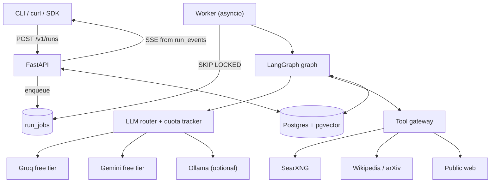
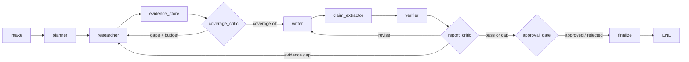
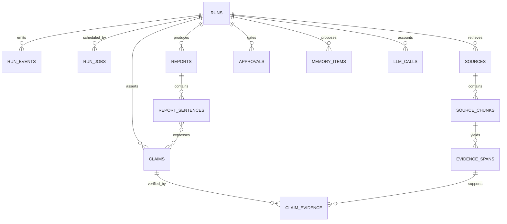

# Design: Autonomous AI Research Agent

| Field | Value |
|---|---|
| Status | Phase 1 complete; authoritative for Phase 2+ |
| Version | 0.1.0 |
| Date | 2026-11-08 |
| Owner | Solo maintainer |
| Scope | Laptop deployment, **$0 billed** budget |
| Related | [Requirements](REQUIREMENTS.md), [ADRs](adr/), [Risk register](RISKS.md), [Quota plan](QUOTA_PLAN.md), [Evaluation plan](EVAL_PLAN.md) |

---

## 0. TL;DR

This is **not** a report generator. It is an **auditable evidence pipeline** that happens to emit prose.

A run decomposes a question, searches the web, stores quotable evidence spans, drafts a report,
extracts atomic claims, verifies each claim against its cited spans, removes or flags unsupported
claims, and publishes only what survives verification. Every citation resolves to a span with a URL,
retrieval timestamp, and verbatim quote.

Two properties shape the architecture:

1. **The writer never emits a URL or a citation marker.** It selects IDs from a closed evidence set;
   the renderer creates markers and the reference list. Invented URLs are impossible by construction.
2. **The whole benchmark runs at $0.** Free-tier tokens and requests are the real budget, so the
   system includes a Postgres-backed quota tracker, deterministic fallback, and record/replay.
   Dollar cost is reported as a clearly labeled shadow price, never as a bill.

The scientific contribution is the benchmark: **single-agent vs multi-agent vs DSPy-optimized**,
with claim-level metrics, paired statistics, and honest reporting of where multi-agent loses.

---

## 1. Problem and users

A user asks *"What is the current evidence that GLP-1 agonists reduce cardiovascular risk, and where
do trials disagree?"* Today they get a search engine and hours of reading, or an LLM answer that is
fluent, uncited, and occasionally invents sources.

**Primary user:** a developer, analyst, or researcher who needs a first-pass, source-linked brief and
must audit every sentence. **Primary interface:** an async HTTP API (start run, stream progress,
fetch report, approve actions). A CLI is a thin client, not a second product.

**What "good" looks like:** the user can inspect any claim in the report and see the exact quoted
span, its URL, when it was retrieved, and the verifier's verdict. If the evidence is insufficient,
the report says so instead of confabulating.

---

## 2. Goals and success criteria

Targets are hypotheses to calibrate in Phase 5, not promises.

| # | Goal | Target (v0.1) | Measured by |
|---|---|---|---|
| G1 | No unsupported assertion ships | 100% of body claims have ≥1 `supported` span | Structural invariant + eval |
| G2 | Claim support rate | ≥ 0.80 on the frozen test split | Verifier + calibrated judge |
| G3 | Citation precision | ≥ 0.85 | Cited span actually supports the claim |
| G4 | Citation recall | ≥ 0.70 | Gold claims covered by a supported, cited claim |
| G5 | Task completion | ≥ 0.90 of runs produce a schema-valid report within budget | Eval harness |
| G6 | Unanswerable questions | ≥ 0.80 correctly reported as insufficient evidence | Category-specific eval |
| G7 | Conflict handling | 100% of contested claims attribute both sides or flag disagreement | Rubric |
| G8 | Reproducibility | Replay of a recorded run yields an identical structured report (modulo IDs/timestamps) | CI replay test |
| G9 | Budget | $0 billed; ≤ 100k tokens and ≤ 25 tool calls per run by default | Ledger |
| G10 | Latency | p50 ≤ 180 s, p95 ≤ 600 s per run | Ledger |
| G11 | Benchmark | 50 questions, 3 seeds on the 10-question test split, paired CIs | Eval report |
| G12 | CI | lint + types + tests < 5 min; 5-question replay eval < 3 min | GitHub Actions |

**Statistical honesty:** n=10 on the test split yields wide intervals. We report them and call
effects directional. A 50-question full matrix is ~53M tokens and 7–8 weeks at free-tier capacity;
the quota-conscious compromise is documented in [QUOTA_PLAN.md](QUOTA_PLAN.md) §3.3.

**Anti-goal disguised as a goal:** "multi-agent wins" is a hypothesis. A well-run negative result is
a valid outcome.

---

## 3. Non-goals (v0.1)

- **Not a chatbot or consumer UI.** API + markdown/JSON report.
- **Not a general browser agent.** No computer use, form filling, or authenticated crawling.
- **Not real-time monitoring.** Runs are user-triggered; no continuous crawling or alerts.
- **Not multi-tenant SaaS.** Single-tenant laptop deployment; bearer-token auth is a stub.
- **Not a paywall circumvention tool.** Respect `robots.txt` and site terms; skip what we cannot fetch.
- **Not a fine-tuning project.** DSPy optimizes prompts/demonstrations; no weights are trained.
- **Not multilingual.** English-first; document the degradation.
- **Not an archive.** Source text is retained for audit and TTL-expired; it is not a web archive.
- **No paid APIs, no paid tracing, no Kubernetes.** Each has a trigger in §10.

---

## 4. Design thesis (why this shape)

### 4.1 The hard problem is provenance, not prose

Models write a plausible report in one call. The failure mode is decorative citations and confident
unsupported claims. The writer is therefore the least powerful component: it may only use spans the
retriever actually fetched, and it may only reference them by ID.

### 4.2 Verification is a separate step with veto power

A single "write and cite" call cannot reliably audit itself. The pipeline is:

```text
draft (structured sentences + span IDs)
  -> claim extraction (atomic claims)
  -> verification (per claim, against declared + retrieved spans)
  -> report critic (repair, research more, or export)
  -> render (markers and references generated from claim→span links)
```

This adds requests, which matters at $0. Claims are batched (≈5 per verifier call) and evidence is
truncated aggressively to keep the run near 80k tokens (see [QUOTA_PLAN.md](QUOTA_PLAN.md) §1).

### 4.3 Architecture is an experimental variable

The multi-agent graph exists to separate planning, retrieval, verification, and writing so each can
be measured. It is not assumed to beat a single agent. E0–E3 share tools, budgets, router, evidence
store, and output schema; E0 also gets a compute-matched variant if quota allows. Without that,
"multi-agent is better" usually means "it spent 3× more".

### 4.4 Replay is a first-class requirement

Every LLM, search, and fetch response is cacheable by a semantic request hash. CI runs on recorded
cassettes with zero network calls; a cache miss is a hard failure. This makes evals repeatable,
cheap, and reviewable, and it protects against free-tier model drift.

---

## 5. Architecture

### 5.1 System context



**Deployment:** one container + Postgres + SearXNG via docker-compose; one API process and one worker
process on a laptop. No Redis, Celery, Kafka, or separate vector database. The Postgres queue is the
only scheduler; LangGraph checkpoints hold execution state (ADR-0007).

**Boundaries:**

| Component | Owns | Must not |
|---|---|---|
| FastAPI | HTTP contracts, auth stub, SSE, idempotency, OpenAPI | Contain agent logic |
| Worker | Claiming jobs, heartbeats, resuming graphs | Decide research strategy |
| Graph runtime | State, routing, checkpoints, interrupts, budget checks | Call providers directly |
| Nodes / DSPy modules | One LLM step each, typed input/output | Control flow, global retries |
| LLM router | Provider selection, quota, retries, accounting, cache | Know research semantics |
| Tool gateway | Search/fetch/parse/retrieve, timeouts, SSRF/domain policy | Verify claims |
| Evidence store | Chunking, embeddings, dedupe, hybrid retrieval, offsets | Decide report structure |
| Persistence | Runs, events, sources, claims, reports, approvals, quota | In-memory truth |

### 5.2 Process model: Postgres queue + SSE

- `run_jobs` holds scheduling state: `status`, `priority`, `available_at`, `locked_at`, `locked_by`,
  `attempts`. Workers claim with `SELECT ... FOR UPDATE SKIP LOCKED`; a heartbeat extends the lease;
  stale leases are reclaimed.
- LangGraph checkpoints hold execution state. A worker restart resumes from the last completed node,
  not from the beginning.
- `run_events` is append-only with a monotonic `bigserial` ID. `GET /v1/runs/{id}/events` tails it and
  supports `Last-Event-ID`, so SSE reconnect is trivial and no in-memory pub/sub is needed.
- Quota exhaustion sets `paused_quota` and a future `available_at` (next UTC reset). Resume is
  idempotent because the checkpoint already records completed work.

This is deliberately less capable than Celery; it is also one less service to operate. Revisit if we
need multiple workers with independent queues or a dead-letter UI (Phase 7 trigger).

### 5.3 Orchestration, state, and termination



**State.** LangGraph state is a `TypedDict` with explicit reducers; every field is a typed Pydantic
model or a typed collection. Large payloads (page text, chunks, embeddings) live in Postgres, not in
state; the checkpoint carries IDs and bounded summaries.

| Field | Type | Reducer |
|---|---|---|
| `run_id`, `trace_id` | `UUID`, `str` | replace |
| `question`, `constraints` | `ResearchQuestion`, `RunConstraints` | replace |
| `plan` | `Plan` | replace |
| `findings` | `list[SubQuestionFinding]` | append, dedupe by `sub_question_id` |
| `source_ids`, `span_ids` | `set[...]` / `dict[...]` | union / merge by hash |
| `draft` | `ReportDraft \| None` | replace |
| `claims` | `dict[ClaimId, Claim]` | merge |
| `verdicts` | `dict[ClaimId, Verdict]` | replace per claim |
| `usage` | `Usage` (steps, tool calls, tokens, requests, shadow cost) | sum |
| `loops` | `LoopCounters` (research, revision) | increment |
| `degradations` | `list[Degradation]` | append |

**Rules.** No bare `dict[str, Any]` crosses a module boundary; the state `TypedDict` is the single
exception because LangGraph requires a mapping, and it is fully annotated.

**Budgets and termination.** Defaults live in `config/budgets.yaml`: 40 steps, 25 tool calls, 100k
tokens, 600 s, 2 research loops, 2 revision loops, 6 plan items, 12 sources, 40 claims. A single
`BudgetGuard` is called at every node entry and before every tool/LLM call. Any cap routes to
`finalize` with a partial report and a `degradation` record, not an exception.

Termination argument: the graph is finite; every loop has a counter cap; counters are strictly
monotonic; `recursion_limit = max_steps * 4 + 20` is a backstop. A **no-progress guard** ends the
research loop when two consecutive critic rounds add no new sub-question, query, or source. No
unbounded `while` exists outside a node's bounded tool loop.

### 5.4 Agents and the DSPy boundary

DSPy owns **behaviour**; LangGraph owns **control flow, state, budgets, and approvals**. Nodes call a
stable typed interface and never import DSPy types.

| Node | Responsibility | DSPy signature (Phase 6) | Hand-written fallback |
|---|---|---|---|
| Planner | Decompose into ≤6 sub-questions with dependencies | `DecomposeQuestion` | Required |
| Researcher | Generate queries; search → fetch → extract | `GenerateQueries` | Required |
| Evidence store | Chunk, embed, dedupe, rank, extract spans | — (deterministic) | n/a |
| Coverage critic | Find gaps; decide continue/stop | `CritiqueCoverage` | Required |
| Writer | Section sentences with span IDs from a closed set | `WriteSection` | Required |
| Claim extractor | Atomic, decontextualized claims | `ExtractClaims` | Required |
| Verifier | Verdict + rationale + supporting quote | `VerifyClaim` | Required |
| Report critic | Repair, research more, or export | `CritiqueReport` | Required |

Every compiled artifact ships with a manifest: optimizer, seed, dataset hash, metric version,
scores, token cost, and git SHA. A missing or invalid artifact falls back to hand-written prompts
(FR-18) rather than failing a run. Runtime refuses unversioned artifacts outside `local`.

**Uncertainty:** the resolved versions (LangGraph 1.2.20, checkpoint-postgres 3.2.0, DSPy 3.4.1) are
**not yet API-verified**. Phase 1 starts with the spike in [PHASE1_API_NOTES.md](PHASE1_API_NOTES.md);
adapters stay thin and versions are pinned after verification.

### 5.5 Evidence store and retrieval

- **Extraction:** `trafilatura` main-content extraction; PDF text layer via `pypdf`; page-level
  offsets retained. No OCR (documented limitation).
- **Chunking:** 600–900 tokens, ~15% overlap, sentence-boundary aware. Chunk IDs are stable per
  content hash.
- **Embeddings:** local `fastembed` with `BAAI/bge-small-en-v1.5` (384 dimensions). No torch, no API
  cost. The model and dimension are stored with every chunk; mixed-dimension queries are refused.
- **Dedupe:** canonical URL → content SHA-256 → near-duplicate SimHash → embedding cosine > 0.95.
  Aliases are recorded so citations resolve to the canonical source.
- **Retrieval:** pgvector HNSW (cosine) + Postgres full-text (`tsvector`, `ts_rank_cd`), fused with
  Reciprocal Rank Fusion (k=60), optional recency/authority boost for time-sensitive questions.
  Pure vector search is rejected: it misses exact entities, product names, and numbers.
- **Extraction quality** is a first-class field: `high`, `low` (thin text/JS shell), `failed`.
  Low-quality sources rank lower and are excluded from numeric claims.
- **Context packing** is budget-aware: reserve tokens for instructions/output, rank spans, cap per
  source, prefer quotes over whole pages.

### 5.6 Single-agent baseline and fairness

Both architectures implement one `ResearchArchitecture` protocol:

```python
class ResearchArchitecture(Protocol):
    async def run(self, question: ResearchQuestion, config: RunConfig) -> RunResult: ...
```

Fairness controls (FR-15):

- same tool gateway, router, quota, evidence store, budget guard, and report schema;
- same retrieval depth and verification step for E0; no multi-agent-only tools;
- architecture and prompt mode recorded in run metadata;
- per-run steps, tokens, requests, and wall-clock reported for every arm;
- **compute-matched E0** (same median steps/tool calls as E1) as an optional ablation, because
  otherwise architecture is confounded with spend.

The single agent is a ReAct loop with `search`, `fetch`, `retrieve`, `write_report`, bounded by the
same budgets. It is not a strawman: it gets the same evidence and the same output contract.

### 5.7 Evidence and citation model (the core)

```text
Run
 └── Source            (URL, canonical URL, fetched_at, content hash, status, quality)
      └── Chunk        (ordinal, text, tokens, embedding, tsv)
           └── EvidenceSpan (quote, char offsets, retrieved_at, span hash)
Claim ──< ClaimEvidence >── EvidenceSpan   (supported | contradicted | insufficient)
ReportSentence ──< Claim
```

An **EvidenceSpan** is the atomic unit of proof: a verbatim quote with offsets into a stored chunk.
A citation is a claim→span link; the renderer resolves it to URL + retrieval timestamp.

**Invariants:**

- **I1 — Closed set:** the writer receives span IDs and may only reference those. Unknown IDs are a
  schema violation.
- **I2 — No model-generated URLs:** URLs enter only through the retriever/renderer.
- **I3 — No silent unsupported claims:** a claim with no `supported` verdict is removed, or retained
  only in a labeled "Unverified claims" appendix. It never appears as body fact.
- **I4 — Quote fidelity:** every cited quote exists verbatim in its chunk at the recorded offsets;
  checked at ingest and again at render.
- **I5 — Timestamped evidence:** every span has `retrieved_at`; time-sensitive reports show `as_of`.

Verdicts are exactly `supported`, `contradicted`, or `insufficient` (FR-21). Conflict is handled at
the claim level: a claim with both supporting and contradicting spans is marked `contested`, and the
report must attribute both positions rather than pick a winner silently.

### 5.8 Verification pipeline

1. **Extract** atomic claims from draft sentences (split conjunctions, resolve pronouns, record the
   declaring sentence and its declared spans).
2. **Retrieve** additional candidate spans for each claim (the writer's declared spans are a starting
   point, not a ceiling).
3. **Verify** in batches of ~5 claims: return verdict, confidence, rationale, and a supporting quote.
   A verdict without a quote that exists in the span is downgraded to `insufficient`. This cheap
   guard catches verifier hallucination.
4. **Resolve** at the claim level: any `contradicted` span with credible provenance blocks a clean
   `supported`; mark `contested` and require attribution.
5. **Repair** via the report critic: rewrite with better evidence, send the researcher after a gap, or
   remove/flag. Unsupported claims are never silently kept.
6. **Render** markdown/JSON from the verified structure. The renderer rejects dangling citations and
   emits the reference table with URL, title, retrieval timestamp, and quote.

**Numeric claims** get special handling: normalize units, declare tolerance (source precision or
±1%), and require the number to appear in the supporting context. A number that matches but refers
to a different entity does not count. This gets its own test suite; entailment models fail here most
often.

### 5.9 Memory and human approval

| Memory | Contents | TTL | Write path |
|---|---|---|---|
| Short-term | Graph state + checkpoints | Run + 30 days | Automatic |
| Episodic | Runs, reports, claims, sources | 1 year | Automatic |
| Semantic | Approved findings/preferences | 90 days / no TTL for preferences | Approval-gated |
| Procedural | Query patterns per domain | 180 days | Phase 7, approval-gated |

Every memory item carries provenance (`run_id`, `span_id` where applicable), confidence, and an
expiry. Memory never overrides retrieved evidence; it may only propose queries or preferences. Users
can list and delete memory items. Writes are PII-scrubbed.

**Approval gates** use LangGraph `interrupt()` with the checkpoint as the durable record:

| Gate | Default trigger |
|---|---|
| `expensive_search` | Projected batch above 20k tokens |
| `memory_write` | Any long-term write |
| `export` | Before a report is published/exported |
| `low_confidence` | > 20% of claims remain `insufficient` at export |

Approvals are rows with `status`, `kind`, `payload`, `decided_by`, `decided_at`, `reason`, and a TTL
(default 24 h). Approve/reject is a conditional transition from `pending`, so a double-click cannot
double-resume. An expired approval does **not** silently proceed; the run finalizes with a draft and
a degradation note. A rejection includes a reason and produces a partial report.

### 5.10 Free-tier LLM router and quota

A thin **OpenAI-compatible client + router**, not LiteLLM (ADR-0002):

1. Provider adapters supply base URL, auth, model aliases, capabilities, and limits.
2. A capability filter checks context length, JSON mode, tools, and streaming.
3. A quota check reserves requests/tokens in Postgres before the call.
4. Selection is deterministic by role, priority, capability, headroom, and health.
5. Retries use exponential backoff + jitter on 429/5xx; 4xx is not retried except 408/409.
6. Fallback order: Groq → Gemini → Ollama (configurable). Ollama is disallowed for benchmark runs
   by default so results stay comparable.
7. Every call is cached and accounted (provider, model, tokens in/out, latency, cache hit, attempts).

| Role | Preferred order | Why |
|---|---|---|
| Planner / writer / critic | Gemini → Groq → Ollama | Long context, better synthesis |
| Extractor / verifier | Groq → Gemini → Ollama | Fast, cheap, structured output |
| Judge | Opposite family from generator | Reduce self-preference bias |

**Quota state:** `quota_usage(provider, model, day_utc)` and `quota_reservations` with expiry so a
crashed worker cannot leak quota. Calls reserve, then commit actual usage and release the remainder.
When all providers are exhausted, the job becomes `paused_quota` and resumes after the UTC reset.
Operate at ≤80% of any daily cap. Limits are **config, never code**; the template values are
placeholders to verify ([providers.example.yaml](../config/providers.example.yaml)).

### 5.11 API surface

| Method | Path | Purpose |
|---|---|---|
| `POST` | `/v1/runs` | Start a run; requires `Idempotency-Key`; `202 {run_id}` |
| `GET` | `/v1/runs/{id}` | Status, usage, degradations |
| `GET` | `/v1/runs/{id}/events` | SSE; `Last-Event-ID` replay |
| `GET` | `/v1/runs/{id}/report` | Structured report JSON |
| `GET` | `/v1/runs/{id}/report.md` | Rendered markdown |
| `GET` | `/v1/runs/{id}/usage` | Tokens, requests, shadow cost, latency, steps |
| `GET` | `/v1/runs/{id}/trace` | Node/tool/LLM span summary |
| `POST` | `/v1/runs/{id}/cancel` | Cooperative cancel at the next budget check |
| `GET` | `/v1/approvals?status=pending` | Pending approvals |
| `POST` | `/v1/approvals/{id}/approve` | Approve and resume |
| `POST` | `/v1/approvals/{id}/reject` | Reject; finalize with a draft and reason |
| `GET`/`DELETE` | `/v1/memory/{id}` | Inspect or delete memory |
| `GET` | `/healthz`, `/readyz`, `/version` | Ops |

**SSE** events: `run.started`, `node.started`, `node.completed`, `tool.called`, `llm.called`,
`approval.requested`, `approval.decided`, `report.ready`, `run.completed`, `run.failed`,
`run.cancelled`, `run.degraded`, `quota.paused`, `quota.resumed`. Shape:
`{"id": 42, "type": "node.completed", "run_id": "...", "ts": "...", "data": {...}}`.

**Idempotency:** unique `(user_id, key)`; same key + same body returns the original run; different
body → `409`. **Auth:** single bearer token from `API_AUTH_TOKEN`, constant-time compare; labeled a
stub. **Errors:** RFC 9457 `application/problem+json` with `trace_id`.

### 5.12 Observability and accounting

- One trace per run (`trace_id` = `run_id`), spans for nodes, tool calls, LLM calls, retrieval, and
  verification. OTel SDK with an optional exporter; no paid tracing dependency.
- JSON logs with `run_id`, `node`, `event`, `attempt`, `latency_ms`, `tokens`, `requests`, `cache_hit`.
  No page text and no prompts by default (hash + length only).
- `run_events` is the append-only audit log and SSE source. `llm_calls` and `tool_calls` are the
  accounting source of truth; summaries are derived, never recomputed from logs.
- **Cost at $0:** report tokens in/out, requests, wall-clock, and a clearly labeled shadow cost
  (tokens × reference price). Do not present shadow cost as billed spend.
- Sampling: 100% errors and eval runs; configurable for success in local dev.

### 5.13 Safety and guardrails

| Threat | Control |
|---|---|
| Prompt injection via retrieved content | Treat text as data: delimited blocks, explicit system rule, no tool calls sourced from content, output constrained to span IDs; canary suite; optional classifier in Phase 7 |
| SSRF | Resolve DNS, reject loopback/private/link-local/metadata IPs, re-check on redirects (max 3), http/https only, byte/time caps |
| Malicious files | PDF page/byte caps, no JS execution, content-type allowlist, parser isolation by process boundary in Phase 7 |
| Domain abuse | Per-run allow/deny lists, robots.txt, known-bad feeds, no authenticated crawling |
| Secret leakage | Env only, redaction of Authorization/keys, cassette scanner before commit |
| Cost/quota abuse | Auth, per-key rate limits, per-run caps, global daily cap, quota tracker |
| Output injection | Escape HTML, sanitize markdown if rendered, CSP on any future UI |
| Supply chain | `uv.lock`, pinned Action versions (full SHAs in Phase 7), Dependabot; no unpinned `latest` in release images |
| Privacy | Public questions only (free tiers may train on prompts), TTLs, delete endpoint, PII scrub |

**Out of scope for v0.1:** tenant isolation, SSO, GDPR workflows, malware scanning. Do not expose the
API publicly without Phase 7 work.

---

## 6. Data model



| Table | Key columns | Notes |
|---|---|---|
| `runs` | `id`, `user_id`, `question`, `architecture`, `status`, `config`, `usage`, `idempotency_key`, `trace_id` | Unique `(user_id, key)`; status enum includes `paused_quota` |
| `run_jobs` | `run_id`, `status`, `priority`, `available_at`, `locked_at`, `locked_by`, `attempts` | `SKIP LOCKED`; lease + heartbeat |
| `run_events` | `run_id`, `seq` (bigserial), `type`, `payload`, `ts` | Append-only; SSE replay + audit |
| `sources` | `id`, `run_id`, `url`, `canonical_url`, `domain`, `fetched_at`, `status`, `content_hash`, `text`, `extraction_quality` | Content hash dedupes |
| `source_chunks` | `id`, `source_id`, `ordinal`, `text`, `token_count`, `embedding vector(384)`, `tsv` | HNSW + GIN; `pg_trgm` for fuzzy |
| `evidence_spans` | `id`, `run_id`, `source_id`, `chunk_id`, `quote`, `char_start`, `char_end`, `retrieved_at` | Unique offsets per chunk |
| `claims` | `id`, `run_id`, `report_version`, `sentence_id`, `text`, `claim_type`, `status`, `confidence` | `draft → verified / contested / flagged / removed` |
| `claim_evidence` | `claim_id`, `span_id`, `relation`, `confidence`, `rationale`, `verifier_model` | Unique pair; relation is the 3-value verdict |
| `reports` | `id`, `run_id`, `version`, `status`, `markdown`, `structure`, `content_hash`, timestamps | Immutable once approved |
| `report_sentences` | `id`, `report_id`, `section`, `ordinal`, `text` | Links to claims |
| `approvals` | `id`, `run_id`, `checkpoint_id`, `kind`, `payload`, `status`, `decided_by`, `decided_at`, `reason`, `expires_at` | Conditional transition from `pending` |
| `memory_items` | `id`, `user_id`, `kind`, `content`, `embedding`, `provenance_run_id`, `confidence`, `expires_at`, `approved_by` | No write without provenance + approval |
| `llm_calls` | `provider`, `model`, `role`, `tokens_in`, `tokens_out`, `latency_ms`, `cache_hit`, `attempt`, `run_id`, `node` | Accounting source |
| `tool_calls` | `tool`, `request_hash`, `status`, `latency_ms`, `bytes`, `cache_hit` | Search/fetch/embed |
| `quota_usage` | `provider`, `model`, `day_utc`, `requests`, `tokens_in`, `tokens_out`, `reserved` | Atomic reserve/commit |
| `quota_reservations` | `id`, `provider`, `model`, `tokens`, `expires_at`, `run_id` | Expire to avoid leaks |
| `provider_health` | `provider`, `cooldown_until`, `last_error` | Fallback decisions |
| LangGraph checkpoints | library-owned | Do not migrate by hand |

Eval tables live in a separate `eval` schema so production queries never scan benchmark data.
Retention: source text 90 days, reports/claims 1 year, events 1 year, raw LLM payloads 30 days
(redacted), memory per TTL.

---

## 7. Failure modes

| Failure | Detection | Mitigation | User-visible behavior |
|---|---|---|---|
| Search 429/5xx | status, retry budget | backoff → provider fallback | degradation flag, not a crash |
| Empty results | zero hits | reformulate once, then mark sub-question unanswered | coverage gap; critic may stop |
| Paywall / 403 | status, content markers | skip; never bypass | source excluded with reason |
| JS shell / thin text | text yield < threshold | `extraction_quality=low`; lower rank | may trigger another source |
| PDF parse failure | exception / empty text | skip page/source | not cited |
| Invented URL | fetch 404/DNS fail | impossible from writer (I2); validate any URL entering the system | excluded |
| Conflicting sources | opposite verdicts | claim marked `contested`; both positions attributed | transparent disagreement |
| Context overflow | token estimate > budget | section map/reduce, span-preserving; per-source cap | report split; lower depth |
| Prompt injection | canary/classifier, policy violation | spotlight untrusted text, no content-sourced tools | injected text never executed |
| Infinite loop | counters, no-progress guard, recursion limit | hard caps + explicit loop counters | partial report + degradation |
| Duplicate side effects | idempotency replay | unique constraints, idempotent events | exactly-once externally |
| Approval race | two decisions | conditional update on `pending` | one wins, other 409 |
| Approval expiry | TTL check | finalize with draft; do not proceed | explicit expired approval |
| DB unavailable | connection error | fail fast 503; checkpoint resumes | retry later, no lost run |
| Quota exhaustion | reserve rejected | `paused_quota`, `available_at` at reset | run resumes automatically |
| Provider model retired | 404/400 | config alias update + smoke test; replay unaffected | degraded mode |
| Embedding model change | stored model/dim mismatch | refuse mixed-dim queries; re-embed job | stale index flagged |
| Judge drift | calibration delta | pinned judge + prompt hash; recalibrate | eval report flags drift |
| SSE disconnect | client reconnect | event log replay by `id` | no missed events |

---

## 8. Evaluation plan (summary)

Full detail: [EVAL_PLAN.md](EVAL_PLAN.md).

- **Dataset:** 50 public questions, 10 per category (factual, multi-hop, contested, time-sensitive,
  unanswerable), 30/10/10 train/dev/test, gold claims/evidence where possible, frozen cassettes.
  This is the low end of the 50–200 brief, chosen to fit free-tier quota; expanding the test split is
  the top future-work item.
- **Variants:** E0 single-agent hand-written; E1 multi-agent hand-written; E3 multi-agent + DSPy
  verifier + writer. The primary matrix is E0/E1/E3 (3 variants × 10 test questions × 3 seeds = 90
  runs). E2 (DSPy verifier only), A1 (no verifier), A3 (single + verifier), and A5 (compute-matched
  E0) are quota-dependent ablations.
- **Metrics:** factual accuracy, claim support/groundedness, citation precision/recall, URL validity,
  completion, hallucination rate, tokens, requests, shadow cost, latency, steps/tool calls.
- **Statistics:** 3 seeds on the 10-question test matrix (90 runs) for the primary comparison; 1 seed
  on all 50 for coverage. Paired bootstrap 95% CIs, Wilcoxon signed-rank, McNemar for pass/fail,
  Holm correction. With n=10, report effects as directional, not decisive.
- **Judge:** different model family where possible (Gemini judge vs Groq generator), blind randomized
  order, anchored rubric, ≥100 human-labeled claims with Cohen's κ, position/verbosity bias checks.
- **CI:** 5-question replay-only smoke eval per PR, zero network, <3 min; full matrix on release via
  manual workflow. Regression gates after the baseline is frozen.
- **Honesty:** `EVALUATION.md` is generated from raw JSON, never hand-edited; negative results are
  reported; free-tier tokens are the cost metric, not fictitious dollars.

---

## 9. Risks and open questions

Top risks (full register in [RISKS.md](RISKS.md)):

1. **Free-tier quota / drift** — limits change, models retire, capacity may be below plan. Mitigation:
   quota tracker, replay, Ollama, staged collection, 80% rule.
2. **Evaluation power** — n=10 test items; wide CIs. Mitigation: paired tests, CIs, per-category
   breakdown, explicit "directional" language, expand later.
3. **Verifier false positives** — the core quality risk; a permissive verifier makes guarantees
   cosmetic. Mitigation: quote-or-downgrade, numeric tests, adversarial claim set, human calibration.
4. **Library API churn** — LangGraph/DSPy resolved but not verified. Mitigation: Phase 1 spike,
   thin adapters, pinned versions, replay.
5. **Prompt injection** — retrieved content is hostile by default. Mitigation: spotlighting, closed
   tool surface, canaries, no content-triggered actions.
6. **Scope creep** — DSPy + eval + multi-agent + HITL is a lot. Mitigation: phase gates and the cut
   list in [ROADMAP.md](ROADMAP.md).

**Open questions for the owner** (defaults chosen, changeable): approval policy for low-confidence
exports; contested-topic format (positions vs single answer + caveats); memory scope; judge pairing;
report format (Markdown + JSON vs HTML/PDF); benchmark deviation (3 seeds on test only); Docker
availability on the target laptop.

---

## 10. Rejected alternatives

| Decision | Alternative | Why rejected | Revisit if |
|---|---|---|---|
| LangGraph | CrewAI / AutoGen | Weaker explicit typed state and deterministic control | Team wants conversation-centric agents |
| LangGraph | Custom asyncio FSM | Rebuilds checkpoints, interrupts, streaming | Graph outgrows LangGraph |
| Thin OpenAI-compatible router | LiteLLM router | Quota/replay/determinism still need a wrapper; extra abstraction | Maintenance exceeds ~1 day/month |
| Postgres + pgvector | Qdrant / Chroma | Extra ops, no benefit at this scale | >10^7 chunks or multi-region |
| Postgres queue + SSE | Celery + Redis | Extra service for laptop scale | Independent worker pools / DLQ UI |
| Filesystem cassettes | Redis / VCR.py | Reviewable, zero network in CI; VCR is HTTP-brittle | Cassettes exceed repo size |
| Span-level citations | URL-level citations | Cannot verify groundedness or quote fidelity | Never |
| Structured writer output | Free-form markdown + regex | Hallucinated URLs, fragile parsing | Never |
| Claim-level verification | Whole-report judge | No per-claim audit trail; noisy | Never for the core guarantee |
| DSPy inside nodes | DSPy as orchestrator | Loses budgets, HITL, checkpoints | DSPy adds durable state |
| API-first | Full web UI | Distracts from the research/eval story | After v0.1 |
| 50 questions | 200 questions | ~53M tokens for the full matrix; 7–8 weeks | Quota increases or paid budget |

**Over-engineering deliberately avoided:** Kubernetes, microservices, a message broker, a separate
vector DB, a custom frontend, multi-tenant auth, fine-tuning, OCR.

---

## 11. Glossary

- **Claim** — an atomic, checkable assertion extracted from a report sentence.
- **Evidence span** — a verbatim quote with offsets, linked to a source and retrieval time.
- **Verdict** — `supported`, `contradicted`, or `insufficient` for a claim–span pair.
- **Groundedness** — fraction of rendered claims supported by the span they cite.
- **Contested claim** — a claim with credible supporting and contradicting spans; must be attributed.
- **Compute-matched baseline** — single agent given the same step/tool budget as multi-agent.
- **Cassette** — a recorded, content-addressed tool/LLM response used for replay.
- **Shadow cost** — tokens × reference price, labeled as not billed.
